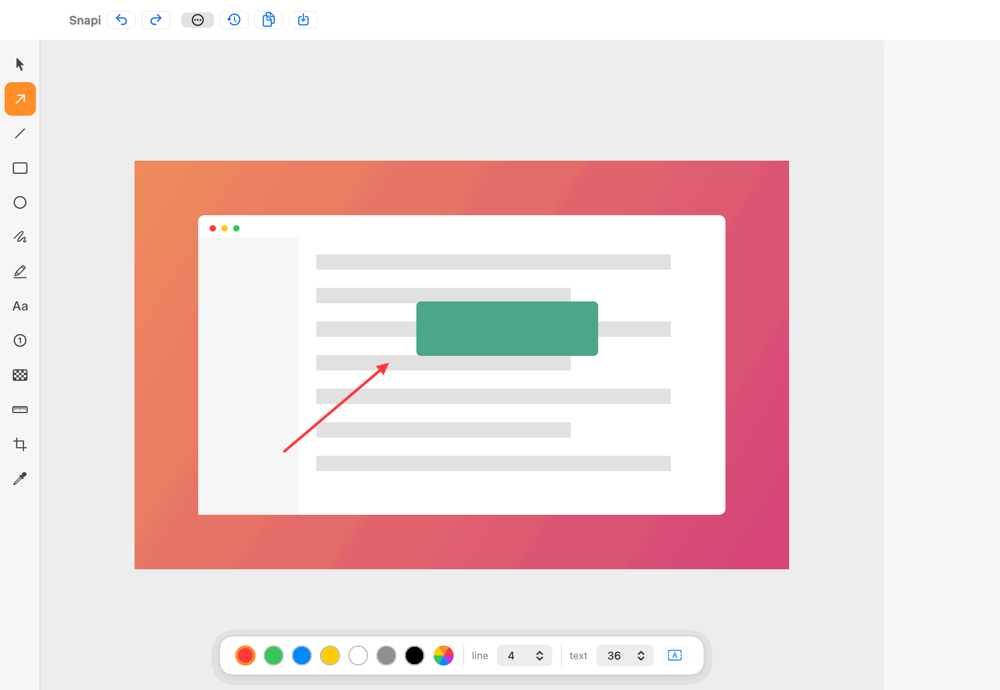

<p align="center">
  
</p>

<p align="center">
  Snapi is a super-fast, feature-packed screenshot app for macOS.<br>
  Capture, edit, copy, save, and share screenshots instantly without slowing down your workflow.
</p>

<p align="center">
  
  
  
  
</p>

<p align="center">
  
</p>

## Features

### Capture
- **Area capture** — drag to select, with frozen screen, crosshair, and live pixel dimensions
- **Fullscreen capture** — the display under your cursor
- **Window capture** — hover highlights windows, click to grab (clean, no shadow)
- **Scrolling capture** — capture long pages; frames are stitched automatically while you scroll
- **Repeat last area** — re-capture the exact same region with one hotkey
- **Delayed capture** — 3 s / 10 s timer from the menu bar
- Multi-display and Retina aware, native pixel resolution

### Edit
- Annotation editor opens instantly after each capture
- Tools: select, arrow, line, rectangle, oval, freehand pen, highlight, text, numbered counters, blur/pixelate, pixel ruler, crop, color eyedropper
- **Handwriting-style text** (bundled [Caveat](https://fonts.google.com/specimen/Caveat) font) with adjustable size and optional background plate
- **Numbered counters with editable labels** — click, type, done; double-click to re-edit
- Figma-style floating property bar — restyle color, stroke width, text size, text background, and **fill vs. outline** for shapes, even *for items already drawn*
- Hold **⇧ Shift** for straight lines, 45° angles, perfect squares and circles
- Full undo/redo, drag to move annotations, per-pixel color sampling with hex copy

### Power tools
- **OCR** — copy text (and QR code payloads) straight from any area of the screen, fully on-device via Apple Vision
- **Background removal** — one click subject isolation to transparent PNG
- **Pin** — float any screenshot always-on-top; drag to move, scroll to resize
- **History** — the last 15 captures live in a sidebar, annotations included; jump back any time

### Private by design
- 100 % offline. No cloud, no accounts, no telemetry, no network calls.
- Screenshots stay on your Mac: clipboard, your chosen folder, and a local history directory.

## Default shortcuts

All hotkeys are remappable in **Settings → Hotkeys**.

| Action | Hotkey |
|---|---|
| Capture area | `⌘⇧2` |
| Capture fullscreen | `⌘⇧1` |
| Capture window | `⌘⇧3` |
| Scrolling capture | `⌘⇧5` |
| OCR area → clipboard text | `⌘⇧O` |
| Pin clipboard / area | `⌘⇧P` |
| Repeat last area | `⌘⇧R` |

### In the editor

| Action | Key |
|---|---|
| Tools | `V` select · `A` arrow · `L` line · `R` rect · `O` oval · `P` pen · `H` highlight · `T` text · `N` counter · `B` blur · `M` ruler · `K` crop · `I` eyedropper |
| Copy & close | `⌘C` |
| Save | `⌘S` |
| Pin | `⌘D` |
| Toggle history | `⌘Y` |
| Undo / redo | `⌘Z` / `⇧⌘Z` |
| Zoom | `⌘+` / `⌘-` / `⌘0`, or **⌃ Ctrl + scroll** |
| Pan | **Space + drag**, or scroll |
| Constrain (straight / square) | hold `⇧` while drawing |
| Close | `Esc` |

## Get Snapi

### Option 1 — Download

1. Download **Snapi.dmg** from the [latest release](../../releases/latest)
2. Open it and drag **Snapi.app** into **Applications**
3. Snapi lives in your **menu bar** (viewfinder icon) — no Dock icon until an editor window is open

**If macOS says the app is from an "unidentified developer":** that appears
only when a release isn't notarized. Either right-click **Snapi.app → Open**
once, or run:

```sh
xattr -cr /Applications/Snapi.app
```

Official releases built with a Developer ID + notarization open normally with
no warning.

### Option 2 — Build it yourself

Requirements: macOS 14+, Xcode 15+, [XcodeGen](https://github.com/yonaskolb/XcodeGen) (`brew install xcodegen`).

```sh
git clone https://github.com/<you>/Snapi.git
cd Snapi
./setup-signing.sh        # once: stable local signing so permissions persist
./build.sh --run          # debug build + launch
./build.sh --release      # release build → build/Build/Products/Release/Snapi.app
```

Or open in Xcode: `xcodegen generate && open Snapi.xcodeproj`.

> **Why `setup-signing.sh`?** macOS ties the Screen Recording permission to the
> app's code signature. A plain build signs *ad-hoc* (a new identity every
> build), so macOS re-asks for permission each time. The script creates one
> stable self-signed identity; `build.sh` reuses it, so you grant permission
> once and it sticks.

## Using Snapi

1. **Grant permission** — on the first capture macOS asks for **Screen Recording**
   (System Settings → Privacy & Security → Screen Recording). Grant it and relaunch
   Snapi. Required once for any screenshot app.
2. **Capture** — press `⌘⇧2` and drag over any part of the screen. The screen
   freezes; a crosshair and live pixel dimensions guide the selection. `Esc` cancels.
3. **Annotate** — the editor opens instantly. Pick tools from the left palette
   (or their letter keys), tune color / stroke / text in the floating bar at the
   bottom. Select (`V`) any drawn item to restyle or move it. Hold `⇧` while
   drawing for straight lines and perfect shapes.
4. **Ship it** — `⌘C` copies the result and closes the window; `⌘S` saves a file
   (Desktop by default); `⌘D` pins it floating on top of everything.
5. **Come back later** — the history sidebar keeps your last 15 captures with
   annotations. Click a thumbnail to reopen, `⌘Y` toggles the panel.

Everything else — window capture, scrolling capture, OCR, background removal,
delayed shots — is in the menu bar menu or on the hotkeys listed above.
Defaults, formats, save folder, and every hotkey are configurable in **Settings…**

> `⌘⇧3`/`⌘⇧5` collide with macOS' built-in screenshot shortcuts. Either remap
> Snapi's hotkeys in Settings, or disable the system ones in
> System Settings → Keyboard → Keyboard Shortcuts → Screenshots.

## Project layout

```
Sources/
├── AppDelegate.swift          # menu bar app, hotkey wiring
├── CaptureEngine.swift        # ScreenCaptureKit wrapper
├── CaptureController.swift    # capture flows (area/window/scroll/OCR/…)
├── AreaSelection/             # frozen-screen selection overlay
├── WindowCapture/             # hover-highlight window picker
├── ScrollCapture/             # timed capture + row-signature stitcher
├── Editor/                    # annotation editor (canvas, tools, prop bar, history)
├── OCRService.swift           # Vision text + QR recognition
├── PinManager.swift           # floating pins
├── HistoryStore.swift         # rolling capture history
└── Settings/                  # SwiftUI settings + hotkey recorder
```

No third-party dependencies — AppKit, ScreenCaptureKit, Vision, and Core Image only.

## License

[MIT](LICENSE). The bundled Caveat font is licensed under the
[SIL Open Font License](https://scripts.sil.org/OFL).
